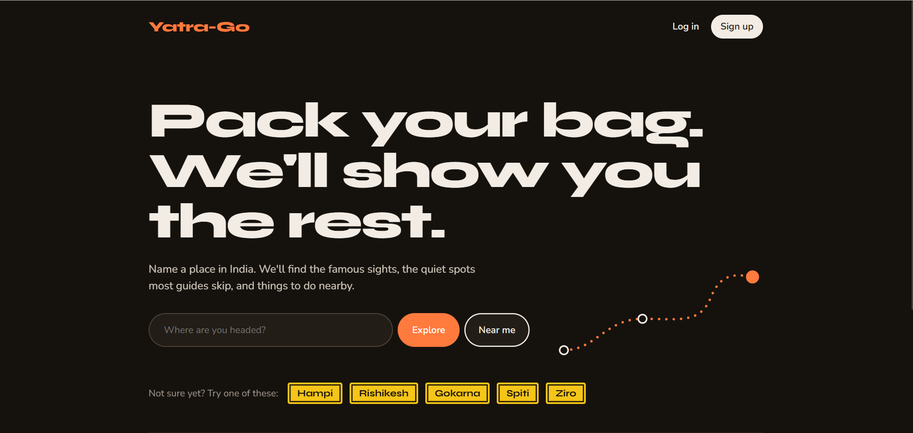
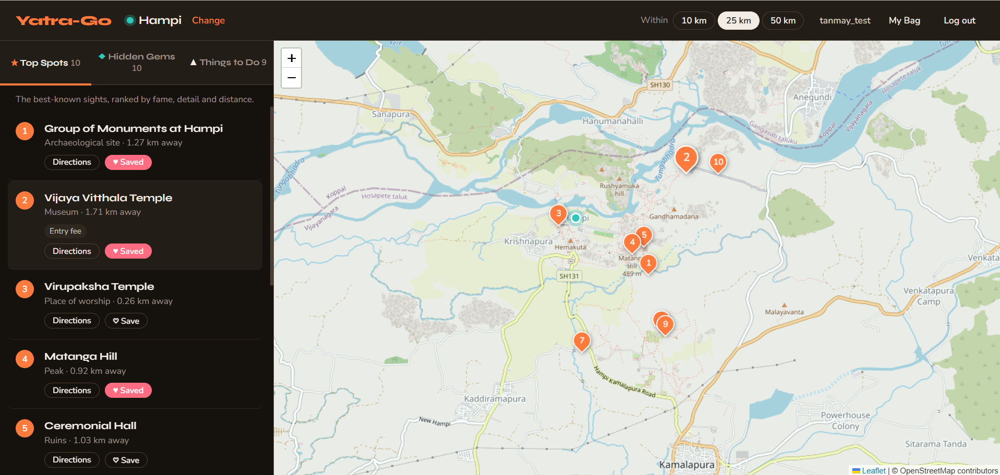
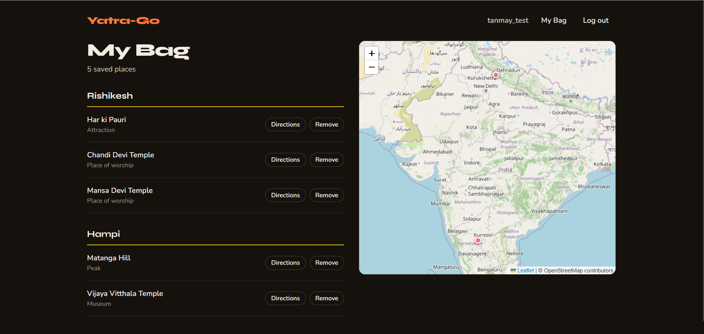

# Yatra-Go

**Pack your bag. We'll show you the rest.**

Yatra-Go is a travel discovery web app for India, built for the solo traveller who has picked a
destination but not a plan. Type a place (or tap *Near me*) and get three ranked lists around it:

- **★ Top Spots**: the sights everyone talks about
- **◆ Hidden Gems**: well-mapped places without a Wikipedia page, the ones guidebooks skip
- **▲ Things to Do**: treks, camps, rafting, climbing and other activities, closest first

Browsing needs no account. Sign up only when you want to save places to **My Bag** for the trip.
Place data comes from OpenStreetMap. Live traffic comes from TomTom's free tier, and the app still
works without it.

| Landing | Explore | My Bag |
|---|---|---|
|  |  |  |

---

## Features

| | |
|---|---|
| **Search any destination** | Place names are turned into coordinates on the server (OpenStreetMap Nominatim), with caching and a 1 request/second limit |
| **Three ranked lists from one request** | `/api/discover` filters by distance once and ranks the same places three ways |
| **Small towns still work** | If a list has fewer than 5 places, the server asks OpenStreetMap (Overpass) live, in parallel, and caches the answer for 6 hours |
| **List and map linked** | Numbered cards match numbered pins; hover a card to highlight its pin, click a pin to jump to its card |
| **Traffic-aware directions** | Up to 3 road routes with live traffic (TomTom). Busy stretches are coloured by how bad the delay is, and a panel compares time, distance and delay. Start from the town centre or your own location. If TomTom is unavailable it falls back to OSRM routes without traffic |
| **Live directions and walking** | A Car / Walk switch: walking routes follow footpaths (OSRM foot server). Starting from your location, the blue dot follows you and the distance and minutes left count down; leaving the route fetches a new one (at most once a minute) and reaching the place shows "You've arrived" |
| **Shareable URLs** | `/explore?lat=15.34&lon=76.46&name=Hampi&radius=25` can be bookmarked or sent to a friend |
| **Accounts and My Bag** | Sign up, log in, save places from Explore (logged-out users are sent to log in and brought back), My Bag grouped by destination with a map |
| **Careful states** | Loading skeletons, "nothing within 10 km, try 25 km?" with a one-click fix, error with Retry |
| **Design system** | Colours, fonts and spacing as CSS variables in one file; dark mode; works on phones |
| **Motion with a purpose** | Cards fade in, pins drop, the tab underline slides, the heart pops; all switched off for users who prefer reduced motion |
| **Tested** | 53 automated tests for the ranking maths, the API, security checks, the login flow and directions |

---

## How the ranking works

Every place in range gets scores between 0 and 1, built from three signals:

| Signal | Meaning | Formula |
|---|---|---|
| **fame** | the place has a Wikipedia/Wikidata link on OpenStreetMap | `1` or `0` |
| **detail** | how well mappers have documented it (opening hours, fee, description…) | `min(tag_count / 12, 1)` |
| **closeness** | how near it is to the destination | `1 − distance / radius` (0 at the edge) |

| List | Which places | Score |
|---|---|---|
| **Top Spots** | sights and nature that are famous, or have at least 4 tags | `0.5·fame + 0.3·detail + 0.2·closeness` |
| **Hidden Gems** | sights and nature with **no** Wikipedia link and at least 4 tags | `0.6·detail + 0.4·closeness` |
| **Things to Do** | activities (trekking routes, campsites, climbing, rafting, parks…) | `0.7·closeness + 0.3·detail` |

Hidden Gems are picked first and then left out of Top Spots, so no place appears twice. The weights
are named constants at the top of [`yatra/discover.py`](yatra/discover.py), so they are easy to tune
and explain. Each set adds up to 1, and a test checks that.

---

## Setup

Needs **Python 3.10+**. Commands below are for Windows PowerShell; on macOS/Linux use
`source venv/bin/activate` instead of the second line.

```powershell
python -m venv venv
.\venv\Scripts\activate
pip install -r requirements.txt

copy .env.example .env
python -c "import secrets; print(secrets.token_hex(32))"   # paste the result into .env as SECRET_KEY
# optional: for live traffic, paste a free key from developer.tomtom.com into .env as TOMTOM_API_KEY

python run.py
```

Open **http://127.0.0.1:5000**. The database (`yatra.db`) is created on first start.

Without a TomTom key everything still works; directions just come from OSRM and show no traffic.

The place data (`data/places.csv`, 6,624 places around 98 travel hubs) is already in the repository,
so you don't need to build it to run the app.

### Rebuilding the place data (optional)

```powershell
python scripts/build_places.py --dry-run        # print one query, fetch nothing
python scripts/build_places.py --city Manali    # fetch one city, to test
python scripts/build_places.py                  # fetch every city (20–40 minutes)
python scripts/build_places.py --offline        # rebuild the CSV from cached answers only
```

The script asks OpenStreetMap's Overpass API for sights, nature and activities around each hub
(several mirrors, retries, one request every 3 seconds), caches every answer in `data/.cache/`
so an interrupted run can resume, then cleans the result: drops generic or numeric names
("Temple", "2620"), removes duplicates (same OSM id, or same name within 1 km), and records the
fame and detail signals used by the ranking.

### Running the tests

```powershell
python -m pytest -v
```

53 tests run in about 3 seconds, with no internet needed:

- `tests/test_geo.py`: distance maths (Delhi to Agra is about 180 km in a straight line)
- `tests/test_discover.py`: the ranking rules, on five hand-made places
- `tests/test_api.py`: sign-up, login, save and list, 401 when logged out, users can't see each
  other's bags, passwords are stored hashed, open redirects are blocked, geocode caching
- `tests/test_routing.py`: reading TomTom and OSRM answers, fastest route first, TomTom → OSRM fallback,
  the cache, bad points and the 500 km limit, walking mode (foot server, never TomTom, separate cache, 30 km limit)

Each test gets its own empty database in a temporary folder, and live OpenStreetMap, TomTom and OSRM calls are
replaced with fakes, so the tests never touch your real data or the network.

---

## Project structure

```
ai-travel-recommendation-system/
├── run.py                   start the app:  python run.py
├── requirements.txt
├── .env.example             copy to .env; set SECRET_KEY (and TOMTOM_API_KEY)
├── pytest.ini
├── data/
│   └── places.csv           6,624 places, built by scripts/build_places.py
├── scripts/
│   └── build_places.py      fetches and cleans OpenStreetMap data
├── yatra/                   the Flask app
│   ├── __init__.py          create_app(): the app factory
│   ├── config.py            settings: SECRET_KEY and TOMTOM_API_KEY from .env
│   ├── db.py                SQLite tables: users, bag_items
│   ├── data.py              loads places.csv
│   ├── geo.py               haversine distance (vectorised with numpy)
│   ├── kinds.py             which OSM tags count as sight / nature / activity
│   ├── discover.py          the three ranking functions (no Flask, easy to test)
│   ├── osm.py               live Overpass top-up with parallel requests and a cache
│   ├── routing.py           turns TomTom / OSRM answers into one route format (no Flask, easy to test)
│   └── routes/
│       ├── pages.py         HTML pages: /, /explore, /login, /signup, /bag
│       ├── places.py        /api/discover, /api/search
│       ├── geocode.py       /api/geocode
│       ├── auth.py          /api/auth/register, login, logout, me
│       ├── saved.py         /api/saved (My Bag)
│       └── directions.py    /api/route (car: TomTom traffic + OSRM fallback; walk: OSRM foot)
├── templates/               Jinja pages; base.html is shared, _account.html is the header links
├── static/
│   ├── css/                 base.css (design tokens), motion.css, one file per page
│   └── js/                  one file per page
└── tests/                   pytest: conftest.py, test_geo.py, test_discover.py, test_api.py, test_routing.py
```

```
Browser ──► Flask (create_app)
             ├── pages.py     → HTML pages (Jinja templates)
             ├── geocode.py   → Nominatim (cached)
             ├── places.py    → discover.py ranks rows from places.csv
             │                   └── osm.py tops up thin lists from Overpass (parallel, cached)
             ├── auth.py      → users table (hashed passwords, session cookie)
             ├── saved.py     → bag_items table
             └── directions.py → car: TomTom with traffic (falls back to OSRM); walk: OSRM foot; cached 5 minutes
```

---

## API

| Method | Endpoint | What it does |
|---|---|---|
| GET | `/api/discover?lat=&lon=&radius=25&limit=10` | Top Spots, Hidden Gems and Things to Do around a point (radius 1–100 km) |
| GET | `/api/geocode?q=Hampi` | Place name → `{name, lat, lon}` (India only, cached) |
| GET | `/api/search?q=` | Find places in the dataset by name or city |
| GET | `/api/route?from=lat,lon&to=lat,lon&mode=car` | Up to 3 routes, fastest first, with time, distance, traffic delay and busy stretches. `mode=walk` gives footpath routes without traffic (car up to 500 km, walk up to 30 km, cached 5 minutes) |
| POST | `/api/auth/register` | `{username, email, password}` → creates the account and logs in |
| POST | `/api/auth/login` | `{email, password}` → logs in |
| POST | `/api/auth/logout` | Logs out |
| GET | `/api/auth/me` | The logged-in user, or `null` |
| GET | `/api/saved` | Your saved places (login required) |
| POST | `/api/saved` | Save a place `{osm_id, place, destination, label, lat, lon}` (login required) |
| DELETE | `/api/saved/<osm_id>` | Remove a place from your bag (login required) |

Errors come back as JSON with an `error` message, and for forms an `errors` object keyed by field.

---

## Security notes

- Passwords are hashed with Werkzeug (`scrypt`); the plain password is never stored.
- `SECRET_KEY` and `TOMTOM_API_KEY` live in `.env`, which is not committed. The TomTom key is only used
  by the server and is never sent to the browser.
- Every SQL query uses `?` placeholders, never string formatting.
- Every value from the data, the URL or the user is escaped before it is put into the page.
- `?next=` redirects after login only go to paths on this site (no open redirects).
- Log out is a POST form, not a link.
- Each user can only read and change their own bag.

---

## Built with

Flask · pandas · NumPy · SQLite · Leaflet · OpenStreetMap (map tiles, Nominatim, Overpass) ·
TomTom Routing API (live traffic) · OSRM (fallback and walking routes) · pytest

Place data © [OpenStreetMap contributors](https://www.openstreetmap.org/copyright), available under the ODbL.

---

## Author

**Tanmay Rana** · [github.com/tanmay-005](https://github.com/tanmay-005)
